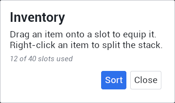
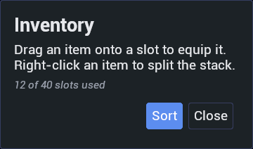
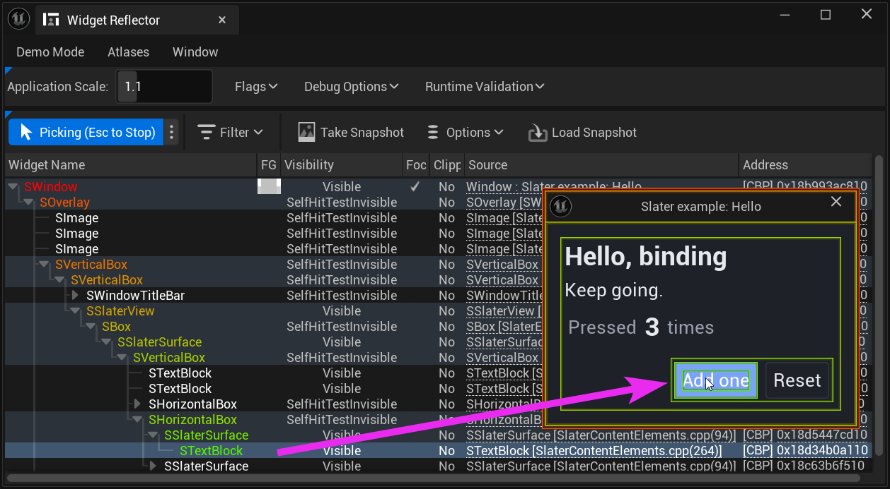

# SlaterUI

> **slater** */ˈsleɪ.tər/* (Slate-er), *noun*
> 1. A tradesperson who lays slate tiles on a roof.
> 2. In Unreal Engine, something that lays out [Slate](https://dev.epicgames.com/documentation/en-us/unreal-engine/slate-user-interface-programming-framework-for-unreal-engine) for you, from a text file, while the game is running.

**Love Unreal? Hate UI work? Tired of binary assets you can't diff? Want to change a layout and see it on screen the instant you save?**

Check out SlaterUI.

SlaterUI is a text-first, declarative UI layer for Unreal Engine. You describe a screen in a small HTML-like file (`.sltr`), and SlaterUI builds real, native Slate widgets from it. Edit the file, save, and the open view updates in place. No C++ recompile, no Blueprint graph, no opaque `.uasset`.

> **Status:** experimental. The syntax and API are still moving.

## A taste

`Panel.sltr`:

```xml
<surface role="UI.Surface.Panel" inset="UI.Space.L" width="360">
  <vbox>
    <text font="UI.Font.Heading" margin="UI.Space.S">Inventory</text>
    <text wrap="true" margin="UI.Space.S">Drag an item onto a slot to equip it. Right-click an item to split the stack.</text>
    <text font="UI.Font.Caption" color="UI.Color.TextMuted" margin="UI.Space.S">12 of 40 slots used</text>
    <hbox margin="UI.Space.M" halign="right">
      <surface role="UI.Surface.Button" inset="UI.Space.M" margin="UI.Space.S">
        <text color="#FFFFFF">Sort</text>
      </surface>
      <surface role="UI.Surface.Panel" inset="UI.Space.M" margin="UI.Space.S">
        <text>Close</text>
      </surface>
    </hbox>
  </vbox>
</surface>
```

Show it from C++ with one line:

```cpp
SNew(SSlaterView).LayoutId(TEXT("Panel")).StyleName(TEXT("Dusk"))
```

Colors, fonts, spacing and surfaces are *tokens* (`UI.Space.L`, `UI.Color.Accent`) that come from a separate style file (`.sltrstyle`). Swap `Dusk` for `Base` and the same layout is re-themed with no change to the layout.

Spacing and colors take either a style token or an inline value, so `margin="UI.Space.M"` and `margin="8"` both work, as do `color="UI.Color.Accent"` and `color="#FF8800"`. Use tokens for anything shared and inline values for one-offs. (Fonts and surface roles are token-only.)

| Base | Dusk |
|------|------|
|  |  |

## Why does this exist?

- **Fast iteration.** Layouts and styles are watched on disk and reloaded live. A broken edit keeps the last good UI on screen and shows the error (file, line, column) instead of crashing.
- **Text you can read, diff and merge.** A UI change is a few lines in a pull request, not a binary blob.
- **Easy for humans and agents.** The syntax is small and strict, and the error messages say what you probably meant. It is a good target for AI coding agents: in our tests, agents given only a one-page cheat sheet and two example files wrote working layouts.
- **Native Slate underneath.** `.sltr` builds ordinary Slate widgets, so there is no separate renderer, and overhead is small. Hot paths can always drop down to plain Slate or UMG.
- **An exit ramp.** If a screen needs to be fixed in code, a layout translates straight to pure Slate (agents are good at that too). You are not locked in.

## Features

- Layouts in a strict XML subset (`surface`, `vbox`, `hbox`, `text`, `image`, `repeat`, `outlet` and more)
- Style files with tokens for colors, fonts, metrics and surfaces; styles can extend each other
- Live reload of layouts and styles, with an in-editor preview tab and a `Slater.Layout <Id>` console command
- Data binding with `{Path}`, through UObject view models (FieldNotification) or plain C++ getters, with list binding via `repeat`
- Build-time checks of tokens and binding paths, with "did you mean" errors and line numbers
- Two-way bindings: `slider`, `checkbox` and `textbox` controls whose `on-change` / `on-commit` write back to the view model through its setters
- Commands (`on-click`), view state (`<state>`, `set-state`, `visible-when`) and stock commands like `ui.close`, `ui.push`, `ui.toggle`
- Templates (`<template>`, `<import>`) for reusable pieces
- Live mouse states: hover and pressed looks on interactive surfaces
- Designer path: a `Slater Layout` UMG widget with MVVM view-model support, and a Game Feature action to add a layout to the HUD
- Escape hatch: `<umg class="...">` embeds a UMG widget inside a layout
- Works with the Widget Reflector: inspect, pick and debug SlaterUI widgets like any other Slate UI

## Widget Reflector

Because `.sltr` builds ordinary Slate widgets, Unreal's Widget Reflector fully works with SlaterUI. Pick a widget on screen to find it in the live tree, inspect its geometry and properties, and debug layout problems the same way you would for hand-written Slate.



## Roadmap (coming soon)

- Popup and context menus
- Collapsible sidebar and animated transitions
- Hover reveal effects and more stock elements (`meter`, `rule`)
- Text formatting and converters in bindings, with localization
- Editor tooling: an XSD and catalog for VS Code completion, and asset pickers in the preview tab
- Per-item state inside `repeat`, a "selected" look driven by view state
- A documented `.sltr` to plain Slate conversion recipe
- Optional layout override layers (for mods and game types)

## Contributing

SlaterUI is young and feedback shapes it.

- **Found a bug or want a feature?** [Open an issue](https://github.com/brokenrockstudios/SlaterUI/issues). A small `.sltr` that reproduces the problem is ideal.
- **Want to change something?** Pull requests are welcome. For anything big, open an issue first so we can talk about the direction.
- **Just tried it?** Tell us what felt good and what didn't.

## License

[MIT](LICENSE) © 2026 Broken Rock Studios
